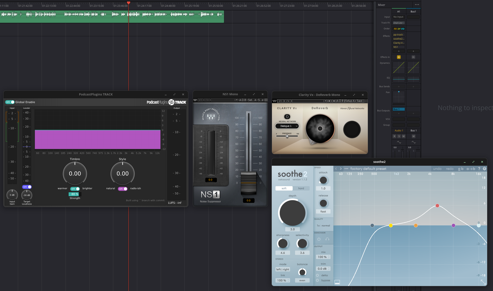
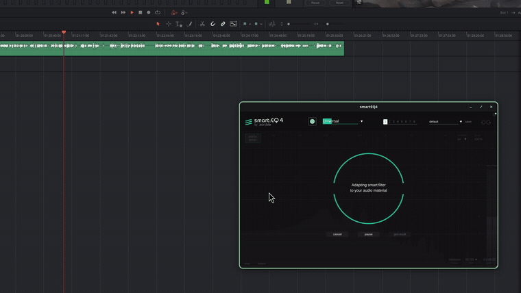
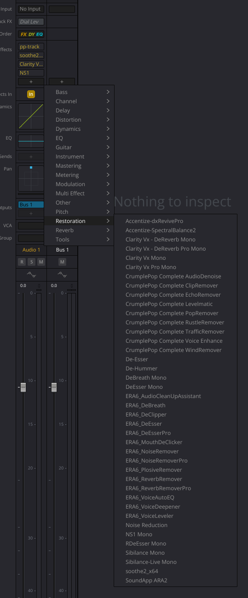
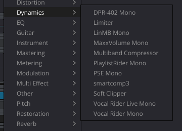
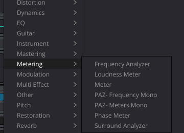

# VST for Resolve on Linux

[](https://github.com/JaySNL/VSTForResolveLinux/releases)
[](LICENSE)
[](#install)
[](CHANGELOG.md)

**VST2, VST3 and CLAP plugins running inside DaVinci Resolve on Linux.** Not bounced out to an
external editor: loaded on the track, with their own GUIs, live on the timeline.

Blackmagic does not support this. Their manual lists VST as macOS and Windows only, and nothing in
the Linux interface loads a VST. `libFairlightPage.so` does carry VST host symbols, but nothing here
has run any of them and why they are unreachable is not established; the evidence is in
[`docs/engineering-log.md`](docs/engineering-log.md). This library takes a different route: it
registers through Resolve's private plugin ABI and hosts the plugins itself.



Four plugins open at once on one track. The **Effects** column in the mixer shows `pp-track`,
`soothe2…`, `Clarity V…`, `NS1`: each effect carries its own name, and each is a real plugin
processing real audio.

## Which release for which Resolve

Requires **DaVinci Resolve Studio 21** on Linux. The free version does not load this ABI.

| Your Resolve | Release | Notes |
|---|---|---|
| 21.0 to 21.1.0 | [v0.3.0.1](https://github.com/JaySNL/VSTForResolveLinux/releases/tag/v0.3.0.1) | |
| 21.1.2 and 21.2 | [v0.3.2](https://github.com/JaySNL/VSTForResolveLinux/releases/tag/v0.3.2) (latest) | Reads Resolve's member offsets at load. If it cannot, it refuses and forwards Resolve's own effects untouched. Verified on 21.2.0.0006. |
| 21.1.2 only | [v0.3.1.1](https://github.com/JaySNL/VSTForResolveLinux/releases/tag/v0.3.1.1) | Side release: v0.3.1 with the offsets fixed in the code. For anyone wary of Microsoft Defender's machine-learning flag on v0.3.1 (`Trojan:Script/Wacatac.C!ml`), a false positive reported to Microsoft; no other engine flags it. Wrong on any other Resolve. |

Method 2 below downloads the latest release. For another one, replace `latest/download` in the URLs
with `download/<tag>`, or check out that tag before building with Method 1.

## Sixty seconds of it, warts included



[Full recording (66s, with audio)](docs/media/demo.mp4): several plugins loaded one after another,
ending with smartEQ4 running a live spectrum analyser while its controls are driven.

It is not a clean take, deliberately. **One plugin opens with an empty editor and only draws after
the effect is removed and undone**, and the recording keeps that in. The others open first time.

## What works

**Plugins land in Resolve's own categories**, mixed in with the built-in Fairlight FX. `De-Esser`,
`De-Hummer`, `Noise Reduction`, `Limiter`, `Multiband Compressor` and `Soft Clipper` below are
Blackmagic's; everything else is ours.

| Restoration | Dynamics | Metering |
|---|---|---|
|  |  |  |

| What | Status |
|---|---|
| **CLAP** | audio + editor |
| **VST3**, native Linux | audio + editor |
| **VST3**, Windows via yabridge | audio + editor |
| **VST2**, Windows via yabridge | audio + editor |
| **Plugin names** | each effect named on the track, not "Delay" |
| **Categories** | Dynamics, EQ, Restoration, Reverb, Metering, Pitch, Guitar… |
| **Shell plugins** | one file publishing hundreds (the Waves WaveShell exposes 718), with a filter to choose which appear |
| **Several at once** | four plugins on one track in the shot above; no shared state between effects |

**Verified working:** soothe2 · smartEQ4 · smartComp3 · the ERA6 suite (14) · CrumplePop Complete
(9) · Accentize SpectralBalance2 and dxRevivePro · Dragonfly reverbs · Airwindows Consolidated ·
Waves (Clarity Vx, NS1, RVox, DeBreath, F6, Vocal Rider, MaxxVolume, PAZ, Sibilance and more) ·
Carla · custom CLAP plugins. **130 plugins listed** on the development machine, 75 of them from a
single Waves shell.

> **Not a supported product.** It patches structures inside Resolve's own process at run time and
> can take Resolve down mid-edit. Save often.

## Install

There are two ways in. **Pick one and follow it to the end**; they do not interleave.

| | Method 1: build it | Method 2: download the binary |
|---|---|---|
| You need | the Carla dev headers, zlib, Xlib, a C++17 compiler | nothing but `curl` |
| Config file | written for you | you add one line |
| Best when | you want the newest code | you want it working in a minute |

Whichever you pick, finish with [Start Resolve](#start-resolve).

### Method 1: build it

`build.sh` compiles, installs **and** writes Resolve's config line for you.

**Step 1. Install the Carla development headers.** `build.sh` compiles `src/carla_host.cpp` against
`/usr/include/carla/includes`; without them it stops at `fatal error: CarlaNative.h`.

| Distribution | Package |
|---|---|
| Arch, CachyOS, Manjaro | `carla` (tested against 2.5.10-4.1) |
| Debian, Ubuntu, Linux Mint | `carla-dev`, from the [KXStudio repositories](https://kx.studio/Repositories) |

Reported on Linux Mint 22.3 by u/slangbein, who also supplied the fix.

**Step 2. Close DaVinci Resolve.** Resolve owns its config file and rewrites it on quit, so an edit
made while it runs is thrown away. `build.sh` refuses to touch the file while Resolve is open.

**Step 3. Build.**

```sh
git clone --recurse-submodules https://github.com/JaySNL/VSTForResolveLinux.git
cd VSTForResolveLinux
./build.sh
```

This compiles and installs into `~/.local/share/BMDAudioPlugins/`: `libfxbridge.so`, the scanner
`fxbridge-scan` (run once at the end, see [The first scan](#the-first-scan)), the gate preload
`libfxbridge-gate.so` and the launcher `resolve-with-fxbridge`. It adds the `BMDPlugins.Path` line
to `~/.local/share/DaVinciResolve/configs/config-fairlight.dat`, keeping a timestamped copy of your
file first. Run it twice and nothing is duplicated.

`FXBRIDGE_NO_CONFIGURE=1 ./build.sh` skips the config step and prints the line instead.
`FXBRIDGE_NO_SCAN=1 ./build.sh` skips the scan.

Continue at [Start Resolve](#start-resolve). Nothing else between here and that section applies to
Method 1.

### Method 2: download the binary

Every release carries a prebuilt `libfxbridge.so`, free of cost, next to the source it was built
from.

**Step 1. Download it.**

```sh
mkdir -p ~/.local/share/BMDAudioPlugins
cd ~/.local/share/BMDAudioPlugins
base=https://github.com/JaySNL/VSTForResolveLinux/releases/latest/download
for f in libfxbridge.so fxbridge-scan libfxbridge-gate.so resolve-with-fxbridge; do
  curl -L -o "$f" "$base/$f"
done
chmod +x fxbridge-scan resolve-with-fxbridge
```

`fxbridge-scan` is the scanner. Run it once before you start Resolve, and it does the slow part out
here where you can watch it:

```sh
~/.local/share/BMDAudioPlugins/fxbridge-scan
```

```
  [##########..............]  42%  139/330  3m11s elapsed  ~4m22s left  MTurboDelayMB
```

`libfxbridge-gate.so` and `resolve-with-fxbridge` are only needed on Resolve 21.1 and later (see
[Start Resolve](#start-resolve)); they are harmless on 21.0.

**Step 2. Close DaVinci Resolve.** It owns the config file and rewrites it on quit, so an edit made
while it runs is thrown away. This step is not optional.

**Step 3. Add one line to the config file.** Open

```
~/.local/share/DaVinciResolve/configs/config-fairlight.dat
```

in a text editor, and add this line anywhere in it:

```
BMDPlugins.Path = /home/YOU/.local/share/BMDAudioPlugins/libfxbridge.so
```

**Replace `YOU` with your own username.** `whoami` prints it. The path has to be written out in
full: `~` and `$HOME` are not expanded here.

#### If Step 3 goes wrong, nothing tells you

Resolve quietly loads its own plugin library and the Audio FX panel looks exactly as it did before.
No error, no warning. Three things have to be right:

- The value is the path to the **`.so` file**, not the folder it sits in.
- The path is **absolute**, with your real username.
- The key only works in **`config-fairlight.dat`**. Resolve keeps it in `config.dat` across restarts
  and ignores it there.

Earlier versions of this readme published the wrong form (the folder, no `=`, and a `~`) until
2026-08-26. Reported by Delirio, who also asked for these two methods to be pulled apart.

#### What the prebuilt binary asks of your system

Compiled on Ubuntu 20.04, so it asks for `GLIBC_2.16`, `GLIBCXX_3.4.22` and `CXXABI_1.3.9` at most:
libstdc++ from GCC 6.1 onward, which covers Ubuntu 18.04, Debian 9, Rocky 8 and Fedora 25 and newer.
Read the floor back rather than trusting it:

```sh
objdump -T ~/.local/share/BMDAudioPlugins/libfxbridge.so \
  | grep -o 'GLIBC[X]*_[0-9.]*' | sort -uV | tail -3
```

Whether **Resolve itself** runs on distributions that old is a separate question, and one this
project has not tested.

### Start Resolve

**Resolve 21.0 and earlier:** start it as usual. The plugins are in the Audio FX panel.

**Resolve 21.1 and later:** start it through the launcher, or the effect list holds Resolve's own
effects and none of yours, with nothing in the log to say why:

```sh
~/.local/share/BMDAudioPlugins/resolve-with-fxbridge
```

21.1 skips the setting that loads external plugin libraries unless an internal check passes. The
launcher preloads `libfxbridge-gate.so`, which patches that check **in memory** only: nothing on
disk is modified, no root is needed, and not using the launcher undoes it. On 21.0 and earlier the
preload finds no gate and writes one line saying so. Arguments are passed on to Resolve;
`RESOLVE=/path/to/resolve` runs an install other than `/opt/resolve/bin/resolve`, and
`FXBRIDGE_GATE=/path/to/libfxbridge-gate.so` points at a gate library elsewhere. The disassembly
and the measurements are in [`docs/resolve-21.1-gate.md`](docs/resolve-21.1-gate.md).

`tools/check-offsets.py` reports whether your Resolve has the gate, without starting it.

### Nothing appeared?

Either method. Ask whether the bridge was loaded at all:

```sh
grep -c fxbridge ~/.local/share/DaVinciResolve/logs/ResolveDebug.txt
```

**Zero** means Resolve never loaded it: the config line is wrong, this is the free version rather
than Studio, or you are on 21.1 or later and did not start through the launcher. **Above zero**
means it loaded, and these lines say what it found:

```sh
grep 'fxbridge.*scan:' ~/.local/share/DaVinciResolve/logs/ResolveDebug.txt | head
```

**Windows plugins need a patched yabridge.** The version in your distribution's repositories draws
plugin GUIs correctly and then takes almost no mouse input. Read [`docs/yabridge.md`](docs/yabridge.md)
before concluding this project is broken. Native Linux CLAP and VST3 plugins need nothing extra.

## Choosing which plugins appear

**Where plugins are looked for.** Per format, in this order: the environment variable
(`CLAP_PATH`, `VST3_PATH`, `VST_PATH`, colon-separated), then the folder under your home
(`~/.clap`, `~/.vst3`, `~/.vst`; VST2 also `~/.lxvst`), then the system folders:

| Format | System folders |
|---|---|
| CLAP | `/usr/lib/clap`, `/usr/local/lib/clap` |
| VST3 | `/usr/lib/vst3`, `/usr/local/lib/vst3` |
| VST2 | `/usr/lib/vst`, `/usr/local/lib/vst`, `/usr/lib/lxvst`, `/usr/local/lib/lxvst` |

Since v0.3.2, `/usr/lib64/{clap,vst3,vst,lxvst}` and
`/usr/local/lib64/...` are searched too, and plugins reached twice through symlinks are listed once.

**Formats.** `FXBRIDGE_SCAN_FORMATS`, default `clap,vst2,vst3`.

**Plugins inside a shell.** `~/.local/share/BMDAudioPlugins/fxbridge-shell-allow.txt`, one
substring per line, matched against the plugin's name. Without this file a shell contributes only
its first plugin, so a 718-plugin shell never floods the menu:

```
# Selects 75 of the WaveShell's 718 plugins
Clarity Vx
RVox
Vocal Rider
DeBreath
```

**Plugins to skip entirely.** `~/.local/share/BMDAudioPlugins/fxbridge-scan-deny.txt`. Written
before the first plugin is opened, listing every plugin found on the machine, all commented out.
Delete the `# ` in front of a line to stop that plugin being opened at all:

```
# /home/you/.vst3/SomethingThatHangs.vst3
/yabridge/
Waves
```

A pattern is a plain **substring of the plugin's full path**, matched without regard to case. It is
not a glob and not a regular expression: `*.vst3` matches nothing, because the asterisk is a
literal asterisk. Your edits are never overwritten; delete the file to have it rebuilt from the
current scan. The check runs before anything is opened, so it also covers a plugin that hangs the
scan.

**Categories.** A VST3's own subcategory is used when the name table has no rule for it. To add a
rule, edit `CategoryFor()` in `src/fx_categories.cpp`; see [`docs/categories.md`](docs/categories.md).

The filters take effect on the next Resolve start. No rebuild.

## The first scan

Reading a plugin's name means opening it, and opening a Windows VST3 through yabridge starts a Wine
host: one to three seconds per plugin on a typical machine, so a few hundred plugins take minutes,
**once**. After that:

- **`fxbridge-scan` does it outside Resolve**, with a progress bar. `build.sh` runs it for you. A
  plugin that faults while being read then takes down a command rather than an edit session.
- **Eight modules are opened at once**; `FXBRIDGE_SCAN_THREADS` changes the number.
- **Nothing learned is thrown away.** The cache
  (`~/.local/share/BMDAudioPlugins/fxbridge-scan-cache.tsv`) is written after every module, so
  Ctrl-C is safe and the next run continues where the last one stopped. A cached start opens
  nothing. Delete the file to force a rescan; it repairs itself if truncated.
- **Only new or changed plugins are read again.** The cache key is the size and modification time
  of the binary inside each bundle.

**Plugins that stopped a start.** `~/.local/share/BMDAudioPlugins/fxbridge-scan-crashed.txt`. You do
not write this one. A plugin that hangs or faults while its name is read takes the start down with
it; a module that is still open at the end of two starts in a row is written here and skipped from
then on. The log says so. The first time proves nothing, so that module is first listed in
`fxbridge-scan-suspect.txt` and opened again. Delete a line from the crashed file to have that plugin
opened again, or delete the file to try all of them.

The measurements, the crash-recovery rules and the scan cache are in
[`docs/first-scan.md`](docs/first-scan.md).

## Settings between sessions

**Your plugin settings live in the Resolve project.** On by default since v0.2.3, nothing to turn
on. They belong to the effect, they move with the project, and they survive a chain that gets
rearranged. Verified with eight effects on one timeline: all eight saved and all eight restored,
including a 2.3 MB smartEQ4 chunk.

**One thing to know.** Resolve writes the effects model only when it already thinks the project
changed, and an edit made inside a plugin's own window is invisible to it. Nothing is lost: your
change is written on the next thing you do that Resolve *can* see, a fader or a clip. If you want a
session that changes nothing else to be covered too, start Resolve with `FXBRIDGE_STATE_STORE=1`.

The full account (how the channel was found, what it cannot do, and the two claims this project got
wrong on the way) is in [`docs/settings.md`](docs/settings.md).

## Latency

Plugins with lookahead (a linear-phase EQ, a limiter, anything oversampled) need the rest of the
timeline delayed to match, or the audio walks away from the picture. Resolve does that compensation
itself; it only has to be told the number. Until v0.2.9 this bridge told it zero for every effect.
It now reports what the plugin reports, so stacking effects no longer pushes the audio out of sync.
The log names each one:

```
[fxbridge] latency: "Acon Digital DeVerberate 3" reports 6144 samples
```

Two things are known and not fixed. Playback starts with a short silence when a high-latency plugin
is loaded; **exports are unaffected**, and the cause is still open. And a plugin that changes its
latency while the project is open may not be re-compensated until it is reopened.

`FXBRIDGE_LATENCY=0` turns the reporting off. Forwarding the playhead position to the plugin
(a "locate") is **off by default** since v0.2.10, because it crashed Resolve with a VST2 through
yabridge; `FXBRIDGE_RESET=1` turns it on. Both exist for narrowing down a problem, not for daily
use. Details in [`docs/latency-and-reset.md`](docs/latency-and-reset.md).

## When Resolve stops responding

**A slow plugin does not only drop audio, it freezes the interface.** Resolve holds one lock per
plugin for the whole of its processing call, and the same lock is taken when the playhead moves or
the audio preview is cleared. While a hosted plugin is working, the next thing you do that touches
that effect waits behind it, and a plugin that takes seconds to answer looks exactly like a hung
application.

Since v0.2.12 a hosted block that takes longer than 50 ms is written to the log by name:

```
audio: SLOW - "MAutoDynamicEq" took 4231.077 ms for 1024 frames (block 1 past the limit, worst 4231.077 ms)
```

`FXBRIDGE_SLOW_MS` moves the threshold. A 1024-frame block at 48 kHz is 21 ms of audio, so 50 ms
has already missed the deadline twice over.

**Nothing is aborted.** A VST3 processing call through yabridge cannot be cancelled once it is in
flight, and pretending otherwise would trade a freeze for a corrupted plugin. What the line buys is
the name of the plugin to remove, which no crash dump carries. The lock order inversion behind the
freeze is in [`docs/freeze-deadlock.md`](docs/freeze-deadlock.md).

**A project save waits at most 10 seconds for a plugin** (since v0.3.2). A plugin that does not
hand over its settings in time is saved with what it gave at its previous save in the session, and
the log names it: `preset: "<name>" did not answer`. The stuck call itself cannot be cancelled, so
that plugin stays unusable until Resolve restarts, but the rest of Resolve keeps working.

## After a Resolve update

Blackmagic rebuilds the class this bridge patches on every release, so a new Resolve can move
something without changing anything you would notice. If a plugin stops working after an update:

1. **Empty effect list.** Check that `BMDPlugins.Path` is still in `config-fairlight.dat` (an update
   can rewrite it out), that on 21.1 or later you start through `resolve-with-fxbridge`, and that
   the scan cache is not empty. If the bridge does not recognise the new Resolve it logs that and
   forwards Resolve's own effects untouched; a `layout:` line in the log names every offset it
   read.
2. **Check without starting Resolve.** `tools/check-offsets.py` needs only `python3`. It prints the
   Resolve version, every slot the bridge uses and a verdict per slot: **ok**, **MOVED** or
   **GONE**; exit code 0 means nothing moved.
3. **Use the matching release.** See [Which release for which Resolve](#which-release-for-which-resolve).

A new Resolve can be checked before installing it; the procedure, the member-offset decoding and
the other tools are in [`docs/after-a-resolve-update.md`](docs/after-a-resolve-update.md).

## Environment variables

Set them in the shell that starts Resolve. For a switch, a value starting with `0` is off and any
other non-empty value is on, except `FXBRIDGE_STATE_STORE`, where only `1` counts.

| Variable | Default | Effect |
|---|---|---|
| `FXBRIDGE_SCAN_FORMATS` | `clap,vst2,vst3` | Which formats are listed |
| `FXBRIDGE_SCAN_THREADS` | `8` | Modules opened at once during a scan |
| `FXBRIDGE_SCAN_KEEP_OPEN` | off | Keep modules open after the scan reads them (old behaviour; many Wine hosts) |
| `FXBRIDGE_SLOW_MS` | `50` | Threshold for the `audio: SLOW` log line |
| `FXBRIDGE_LATENCY` | on | `0` stops reporting plugin latency |
| `FXBRIDGE_RESET` | off | `1` forwards a locate (playhead jump) to the plugin |
| `FXBRIDGE_STATE_STORE` | off | `1` also saves settings for a session that changes nothing else |
| `FXBRIDGE_WINDOW_TYPE` | `dialog` | Editor window type: `dialog`, `utility` or `normal` |
| `FXBRIDGE_OPEN_ON_CLAIM` | off | `1` opens every editor at project load instead of on click |
| `FXBRIDGE_GATE` | `~/.local/share/BMDAudioPlugins/libfxbridge-gate.so` | Gate library used by `resolve-with-fxbridge` |
| `RESOLVE` | `/opt/resolve/bin/resolve` | Resolve binary started by `resolve-with-fxbridge` |
| `FXBRIDGE_NO_CONFIGURE` | unset | `build.sh`: skip the config edit and print the line |
| `FXBRIDGE_NO_SCAN` | unset | `build.sh`: skip the scan |
| `CLAP_PATH`, `VST3_PATH`, `VST_PATH` | unset | Extra plugin folders, colon-separated |

Other `FXBRIDGE_*` variables in `src/` are probes and switches for development and are not
supported.

## Known issues

- **Two plugins draw a GUI but take no mouse input**: Smooth Operator Pro (VST2) and Accentize
  SpectralBalance2 (VST3). Carla reproduces both, so this is not the bridge. Not every plugin has
  been tested.
- **A plugin editor sometimes opens empty**, and fills only after the effect is removed and the
  removal undone. Visible in the recording above. Not diagnosed; it is not tied to one format.
- **A plugin-only change does not make the project dirty.** Settings are kept in the project (see
  [Settings between sessions](#settings-between-sessions)); what is missing is the nudge.
  `FXBRIDGE_STATE_STORE=1` closes the gap.
- **The first start after installing or updating a plugin is slow**, because that is when the scan
  has to open it. See [The first scan](#the-first-scan).
- **A plugin's GUI is a separate window**, not a panel inside Resolve. The inspector panel for a
  bridged effect stays black on purpose. Under Wayland both windows go through XWayland. The window
  is listed in the window switcher and takes the keyboard when it opens; `FXBRIDGE_WINDOW_TYPE`
  accepts `dialog` (the default), `utility` and `normal` if your window manager wants otherwise.
  Since v0.3.2, editor windows also request `_NET_WM_STATE_ABOVE`, so they stay above Resolve.
- **An editor opens when you click the effect**, not when the project loads, which is the last
  thing a large project needs. `FXBRIDGE_OPEN_ON_CLAIM=1` brings the old behaviour back if a
  machine turns out to have no other way to open a window.
- **Resolve sometimes does not exit cleanly.** Undiagnosed.
- **No sidechain.** Resolve shows its sidechain routing only for effects it considers
  sidechain-capable, and a bridged effect is not one. The bridge feeds a plugin's main input only;
  a VST2 plugin's extra inputs receive silence.
- **No top-level "VST" group** like macOS and Windows show. That grouping comes from the plugin
  *type*, and Linux Resolve has no VST type. Categories work; a separate VST section cannot.
- **Audio Units** are not applicable: Apple-only format.
- **Startup used to start a Wine host for every Windows plugin you own.** Fixed in v0.2.5; it was
  the cause of the high-CPU reports. Modules are now closed after the scan reads them.
  `FXBRIDGE_SCAN_KEEP_OPEN=1` restores the old behaviour.
- **Tested on three machines**, all DaVinci Resolve Studio 21, and only one of them is the
  author's. See [CHANGELOG.md](CHANGELOG.md) for what each release fixed and what was confirmed by
  the reporter.

Every release, and what changed in it, is in [CHANGELOG.md](CHANGELOG.md).

## How it works

Resolve on Linux loads its own Fairlight FX through a private Blackmagic plugin ABI, named by a
`BMDPlugins.Path` setting that nothing documents. This library registers through that ABI, clones a
stock effect's menu definition once per scanned plugin, and claims the instance Resolve creates,
then hosts a real VST2, VST3 or CLAP plugin behind it, with its own audio buffers, its own editor
window and no state shared between effects.

- [`docs/categories.md`](docs/categories.md): how a category is decided, and how it is set
- [`docs/yabridge.md`](docs/yabridge.md): Windows plugins, and the branch you need
- [`docs/resolve-21.1-gate.md`](docs/resolve-21.1-gate.md): the 21.1 plugin gate
- [`docs/after-a-resolve-update.md`](docs/after-a-resolve-update.md): checking a new Resolve
- [`docs/first-scan.md`](docs/first-scan.md): scan timings, cache and crash recovery
- [`docs/engineering-log.md`](docs/engineering-log.md): how the ABI was found, and every dead end
  in order. The dead ends are most of the value.

## Prior art

No published implementation was found. `BMDAudioPluginFactory` and `QueryPluginList` return zero
hits across GitHub's indexed code, and web searches turn up only the adjacent tools:
[yabridge](https://github.com/robbert-vdh/yabridge), [LinVst](https://github.com/osxmidi/LinVst) and
[airwave](https://github.com/psycha0s/airwave) let a *DAW* load Windows plugins, which is a different
problem; this project uses yabridge underneath.

That is a search result, not a fact about the world: code search cannot see private repositories,
other forges, or a patch in a forum post. If you got here first, say so and you will be credited.

## Licence

MIT, see [`LICENSE`](LICENSE). Third-party notices in [`THIRD-PARTY.md`](THIRD-PARTY.md).

Parts of this were written with an LLM in the loop. The source and a working binary are both here,
free of cost, so anyone can check what it does rather than take the description on trust.

**Nothing from Blackmagic Design is copied, redistributed or modified on disk.** This loads through
Resolve's own plugin path and patches structures in its own process memory. Uninstalling is deleting
one file.

No Steinberg SDK is used: VST3 goes through [travesty](https://github.com/DISTRHO/DPF), DPF's
clean-room C headers (ISC), and VST2 through a clean-room ABI written for this project.

This is interoperability work: making software talk to plugin formats its vendor chose not to
support on one platform. In the EU, [Directive 2009/24/EC Article 6](https://eur-lex.europa.eu/legal-content/EN/TXT/?uri=CELEX%3A32009L0024)
expressly permits decompilation for interoperability. Resolve's EULA is a separate, contractual
matter; read it and decide for yourself.

For what it is worth, there is **no licensing obstacle to Blackmagic doing this themselves**. The
VST3 SDK is MIT-licensed, with no agreement to sign and no per-platform terms. The Linux gap is a
product decision, not a legal one.
